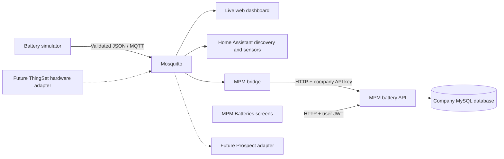

# Libre Solar BMS Remote Monitoring Gateway

An open monitoring prototype that sends simulated battery data through one versioned MQTT contract to a live web dashboard, Home Assistant, and MicroPowerManager (MPM).
It demonstrates how battery measurements and faults can reach both local users and mini-grid operators without maintaining a different BMS data format for each platform.

**Current scope:** the battery producer is a TypeScript simulator, not a connected physical Libre Solar BMS.
The real ThingSet transport adapter and the Prospect adapter are planned.
The MPM battery API and screens live in a separate MPM checkout; this repository contains the bridge and deployment overlay.

For a three-minute demonstration, narration, recording instructions, and a five-minute presentation plan, see [script.md](script.md).

## Contents

- [What is implemented](#what-is-implemented)
- [Architecture](#architecture)
- [Requirements and download](#requirements-and-download)
- [Run the gateway step by step](#run-the-gateway-step-by-step)
- [Integrate Home Assistant](#integrate-home-assistant)
- [Integrate MicroPowerManager](#integrate-micropowermanager)
- [Run scenarios and verify the complete flow](#run-scenarios-and-verify-the-complete-flow)
- [Configuration reference](#configuration-reference)
- [Development and tests](#development-and-tests)
- [Troubleshooting](#troubleshooting)
- [Stop and restart](#stop-and-restart)
- [What makes this project distinctive](#what-makes-this-project-distinctive)
- [Limitations and next steps](#limitations-and-next-steps)
- [Project map and references](#project-map-and-references)

## What is implemented

| Component | Implemented behavior |
| --- | --- |
| Battery simulator | Ten repeatable operating/fault scenarios, four cell voltages, SOC, current, power, temperature, cycles, and BMS state |
| MQTT contract | Version 1.0 JSON schemas for telemetry, events, status, alerts, and simulator controls; simulator validates outgoing canonical messages and incoming controls |
| Mosquitto | Local MQTT broker with persistent retained messages |
| Web dashboard | Live measurements, browser history chart, cell comparison, balancing, recent events, and stale-telemetry detection |
| Home Assistant | Retained discovery for 15 sensors and two binary sensors, dashboard template, BMS state-change notifications, and optional phone/email actions |
| MPM bridge | Periodic health summaries, interval maximum temperature, event/alert forwarding, graceful offline updates, and bounded HTTP retries |
| MPM extension, separate repository | Company-scoped health storage and fault history, integration API-key routes, JWT-protected browser reads, Batteries list/detail screens with polling |
| Diagnostic scripts | Start both projects and compare MQTT measurements with authenticated MPM API reads |

The `alert` contract is supported by the bridge, but there is no active alert/rule generator.
The running simulator publishes `telemetry`, `event`, and `status` messages.

## Architecture



MPM receives HTTP requests from the bridge; it does not subscribe directly to MQTT.
Home Assistant reads the same canonical telemetry as the gateway dashboard.
Discovery messages describe the entities; they are not a second battery telemetry format.

Default topics are:

```text
libre-solar/site-001/BAT-001/telemetry
libre-solar/site-001/BAT-001/event
libre-solar/site-001/BAT-001/status
libre-solar/site-001/BAT-001/control
homeassistant/{sensor|binary_sensor}/libre_solar_site_001_BAT_001/{entity}/config
```

Telemetry is normally published every second.
Telemetry/events are not retained; startup/graceful-shutdown status and discovery configurations are retained.
Canonical publishing uses MQTT QoS 1, which allows duplicate delivery.
Positive battery current means discharge; negative current means charging.
See the [MQTT specification](docs/MQTT_SPECIFICATION.md) for payload examples, schema rules, and all topic details.

## Requirements and download

### Requirements

Use Linux with Bash for the commands below.
Install Git, Docker Engine, and Docker Compose with support for `up --wait`; `openssl` is used for fresh MPM secrets.
Node.js 22 is used by the gateway Docker images and is only needed on the host for development outside Docker.
Internet access is needed for initial image and dependency downloads.

```bash
git --version
docker --version
docker compose version
docker info
```

If `docker info` reports a Docker socket permission error, configure Docker access for your account or use `sudo` consistently for Docker commands and startup scripts.
The full stack includes MPM's MySQL, Redis, PHP services, and frontend; allow more resources than for the gateway alone.
Port defaults are `1883` (MQTT), `3000` (gateway), `8000` (MPM API), `8001` (MPM UI), and `8123` (Home Assistant).
MPM's supplied Compose file also publishes `3306`, `6379`, and `8443`; check for conflicts.

### Download the gateway

```bash
mkdir -p ~/Project
cd ~/Project
git clone https://github.com/mugisha12john/oseas26-libre-solar-bms-monitoring-gateway.git
cd oseas26-libre-solar-bms-monitoring-gateway
```

Alternatively, download the [gateway main-branch ZIP](https://github.com/mugisha12john/oseas26-libre-solar-bms-monitoring-gateway/archive/refs/heads/main.zip), extract it, and rename its directory to `oseas26-libre-solar-bms-monitoring-gateway`.
For a repeatable presentation release, distribute a tested tag or commit archive rather than a moving branch.

### Install the two integration platforms

These are the installation guides used by the team:

1. [Home Assistant: Getting started](https://www.home-assistant.io/getting-started/).
2. [MicroPowerManager: Deployment with Docker Compose](https://micropowermanager.io/installation/deploy-with-docker-compose.html).

Use those guides to obtain the platforms, then follow the project-specific integration steps below.
Both platforms can run locally; downloads/builds require internet initially.
This prototype's local MQTT/HTTP path does not depend on a hosted cloud service, although reliable delivery through outages is not implemented.

### Obtain the MPM version containing our changes

The official MPM installation guide does not establish that prebuilt images contain this project's battery extension.
The local MPM checkout inspected for this documentation is commit `7fb60e7c` (`feat: integrate Libre Solar battery health and live battery views`).
Use a checkout or archive that includes that implementation, not an unrelated upstream version.

**Team MPM integration source download: `MPM_DOWNLOAD_URL` — replace this placeholder with the tested team repository/branch or ZIP link when it is published.**
The [upstream MPM repository](https://github.com/EnAccess/micropowermanager) remains the platform reference; its public contents have not been verified to include the team's commit.

Extract the MPM download as a sibling directory named `micropowermanager`:

```text
~/Project/
├── oseas26-libre-solar-bms-monitoring-gateway/
└── micropowermanager/
    ├── docker-compose.yml
    ├── docker/
    └── src/
```

If using a team Git repository, replace the placeholders before running:

```bash
cd ~/Project
git clone --branch TEAM_MPM_BRANCH TEAM_MPM_REPOSITORY_URL micropowermanager
cd oseas26-libre-solar-bms-monitoring-gateway
```

The MPM archive must include complete source, lockfiles, Dockerfiles, the battery plugin, migrations, provider registration, frontend modules, and routes.
Do not distribute private `.env` files or a private database dump with source downloads.
The diagnostic `report` command calls Git in both repositories; for ZIP-only downloads, use `watch` and container logs instead.

## Run the gateway step by step

All commands below run from this repository's root unless stated otherwise.

### 1. Create local configuration

```bash
# Only creates .env if it does not already exist.
if [ ! -f .env ]; then cp .env.example .env; fi
chmod 600 .env
```

Keep the default `MQTT_HOST=mosquitto` for Docker services.
Leave existing configuration intact on an already configured machine.
The gateway-only demonstration does not require an MPM key.

### 2. Start the independent gateway demo

```bash
docker compose up -d --build mosquitto simulator dashboard
docker compose ps
```

Expect those three services to be running.
This explicit service selection lets you demonstrate the gateway before configuring MPM.
Builds can take several minutes on the first run.

### 3. Open the dashboard

Open [http://localhost:3000](http://localhost:3000).
Confirm SOC, pack measurements, temperature, four cell voltages, BMS state, and the last-updated time appear.
History accumulates while the browser is open; it is not a persistent telemetry database.

### 4. Verify MQTT

```bash
docker compose exec -T mosquitto mosquitto_sub -h localhost \
  -t 'libre-solar/#' -v
```

Expect JSON telemetry on `libre-solar/site-001/BAT-001/telemetry` approximately once per second and a retained `online` status.
Press Ctrl+C to stop the subscriber; the services keep running.
This command uses the broker's bundled client, so a host installation of `mosquitto_sub` is unnecessary.

```bash
docker compose logs --tail 30 simulator dashboard
```

## Integrate Home Assistant

Home Assistant runs separately; `scripts/run-systems.sh` does not install or start it.
If you already have Home Assistant, continue at step 2.

### 1. Install or start Home Assistant

Follow the team's [Home Assistant getting-started link](https://www.home-assistant.io/getting-started/).
On Linux with Docker Engine, a minimal MQTT-only local installation can use:

```bash
mkdir -p "$HOME/homeassistant-libre-solar"
docker run -d --name homeassistant-libre-solar \
  --restart unless-stopped \
  --network host \
  -e TZ=Africa/Kigali \
  -v "$HOME/homeassistant-libre-solar:/config" \
  ghcr.io/home-assistant/home-assistant:stable
```

Use this only when there is no existing Home Assistant instance using port `8123`.
Complete onboarding at [http://localhost:8123](http://localhost:8123).
This MQTT-only example needs no USB/Bluetooth access; consult the [official Linux installation guide](https://www.home-assistant.io/installation/linux/) for other installation types or device access.
For an existing stopped container, use `docker start YOUR_HOME_ASSISTANT_CONTAINER`.

### 2. Connect the MQTT integration

Open **Settings → Devices & services → Add integration → MQTT** and enter the broker address appropriate to your installation:

| Home Assistant location | Broker host | Port |
| --- | --- | --- |
| Host-networked container on the gateway's Linux machine | `127.0.0.1` | `1883` |
| Container attached to the gateway's Docker network | `mosquitto` | `1883` |
| Another machine, VM, or Home Assistant OS | Gateway machine's reachable LAN IP | `1883` |

For the checked-in development broker, leave credentials empty.
Use this existing broker rather than configuring a second broker for the demonstration.
Discovery uses the default `homeassistant` prefix; see [Home Assistant MQTT documentation](https://www.home-assistant.io/integrations/mqtt/).

### 3. Confirm discovery

Look for the device **Libre Solar BAT-001** and its sensors in the MQTT integration.
The simulator publishes 17 retained discovery configurations at startup.

```bash
docker compose exec -T mosquitto mosquitto_sub -h localhost \
  -t 'homeassistant/#' -v
```

If discovery is missing, recreate only the simulator:

```bash
docker compose up -d --force-recreate simulator
```

### 4. Import the dashboard and map entity names

1. Open **Settings → Dashboards** and create a dashboard from scratch.
2. Open its edit menu and **Raw configuration editor**; take control if the UI requires it.
3. Paste the complete contents of [dashboard.yaml](integrations/home-assistant/dashboard.yaml) and save.
4. If importing into a single Manual card instead, paste one card object from the file, not the top-level `title`/`views` document.
5. Compare each referenced entity with **Developer tools → States** and replace missing IDs in your dashboard configuration.

The supplied YAML references entity IDs from an earlier local installation, such as `sensor.libre_solar_bat_001_battery_soc`.
Current discovery supplies the stable unique ID `libre_solar_site_001_BAT_001_soc`; the actual entity ID is chosen or preserved by Home Assistant's registry.
Do not assume every fresh installation will use the YAML's entity names.
See the [official dashboard guide](https://www.home-assistant.io/dashboards/dashboards/) for UI and YAML configuration options.

Confirm the overview, history, cell monitoring, health, and state-change sections display incoming simulator values.
History starts accumulating after integration; raw MQTT events are not exposed as a dedicated Home Assistant event entity.
The supplied SOH card says it is not calculated; treat SOH as unvalidated demo data wherever it appears.

### 5. Notify on BMS state changes

Install [the notification blueprint](integrations/home-assistant/bms-state-notifications.yaml) using the [notification setup guide](integrations/home-assistant/README.md#bms-state-change-notifications).
It watches the discovered BMS state sensor and updates a Home Assistant notification for every transition between `NORMAL`, `LOW_SOC`, `WARNING`, and `FAULT`, including return to normal.
Repeated telemetry and initialization/unavailable changes do not send notifications.
Optional actions can deliver the same message to a Companion phone or an SMTP email recipient configured privately in Home Assistant.

## Integrate MicroPowerManager

### 1. Confirm the integration source is present

```bash
test -f ../micropowermanager/docker-compose.yml
test -f ../micropowermanager/src/backend/app/Plugins/LibreSolarBatteryHealth/routes/api.php
test -f ../micropowermanager/src/frontend/src/modules/LibreSolarBatteryHealth/Batteries.vue
```

Each command should succeed without output.
The integration includes central/tenant migrations and provider registration as well as those files.
Upstream prebuilt `latest` application images alone may omit your local changes, so use the supplied source-build overlay.

### 2. Configure MPM on a new machine

**Skip this step if your MPM environment and company database already work.**
Create these files in `../micropowermanager`, not in the gateway directory.
The [MPM Compose guide supplied by the team](https://micropowermanager.io/installation/deploy-with-docker-compose.html) provides deployment background; the examples below use this checkout's connection name and local ports.

Generate an application key with `openssl rand -base64 32` and a JWT secret with `openssl rand -hex 32`.
Replace every `REPLACE_...` value before startup, using the same database password in both files.

`../micropowermanager/.env.backend`:

```dotenv
APP_ENV=production
APP_DEBUG=false
APP_KEY=base64:REPLACE_WITH_GENERATED_BASE64_KEY
APP_URL=http://localhost:8000
MPM_FRONTEND_URL=http://localhost:8001
MPM_ENV=production
MPM_LOAD_DEMO_DATA=false
DB_CONNECTION=micro_power_manager
DB_HOST=mysql
DB_PORT=3306
DB_DATABASE=micro_power_manager
DB_USERNAME=root
DB_PASSWORD=REPLACE_WITH_LOCAL_DATABASE_PASSWORD
CACHE_DRIVER=redis
REDIS_HOST=redis
REDIS_PORT=6379
SESSION_DRIVER=file
JWT_SECRET=REPLACE_WITH_GENERATED_JWT_SECRET
LOG_CHANNEL=stderr
LOG_LEVEL=info
```

`../micropowermanager/.env.frontend`:

```dotenv
MPM_ENV=production
MPM_BACKEND_URL=http://localhost:8000
```

`../micropowermanager/.env.mysql`:

```dotenv
MYSQL_ROOT_PASSWORD=REPLACE_WITH_LOCAL_DATABASE_PASSWORD
MYSQL_DATABASE=micro_power_manager
```

```bash
chmod 600 ../micropowermanager/.env.backend \
  ../micropowermanager/.env.frontend ../micropowermanager/.env.mysql
```

The root database account is used here for a local demo because MPM creates company databases.
For a deployed system, follow MPM's database access requirements and secret-management guidance.
When accessing MPM from another computer, the frontend backend URL must point to an API address reachable from that computer's browser.

### 3. Build and start the local MPM version

Define this helper in your current Bash terminal, from the gateway root:

```bash
export MPM_SOURCE_DIR="$(cd ../micropowermanager && pwd)"
export GATEWAY_SOURCE_DIR="$PWD"
export MPM_LOCAL_OVERLAY="$PWD/integrations/mpm/local-source.compose.yml"
mpm_local() {
  docker compose --project-directory "$MPM_SOURCE_DIR" \
    -f "$MPM_SOURCE_DIR/docker-compose.yml" -f "$MPM_LOCAL_OVERLAY" "$@"
}

mpm_local config --services
mpm_local build backend frontend scheduler worker
mpm_local up -d --wait --wait-timeout 180 mysql redis
mpm_local up -d --wait --wait-timeout 300 backend frontend scheduler worker
mpm_local exec -T backend php artisan route:list --path=libre-solar
mpm_local exec -T backend php artisan route:list --path=batteries
```

Expect API-key routes under `/api/libre-solar/battery-health` and browser read routes under `/api/batteries`.
Backend startup runs migrations; the overlay disables automatic demo seeding and preserves existing volumes.
The PHP runtime Dockerfile deliberately checks that its preinstalled `composer.lock` matches the downloaded source.
If that check fails, use matching runtime images or rebuild the PHP base images from that same MPM source as explained in [MPM troubleshooting](integrations/mpm/TROUBLESHOOTING.md#build-your-local-mpm-source).
Do not bypass the dependency check to force an incompatible build.

### 4. Initialize a company only on a fresh demo database

If this is a new, empty local demo database, run:

```bash
mpm_local exec -T backend php artisan db:seed --force
mpm_local exec -T backend php artisan migrate-tenant --force
```

This creates Demo Company, its users, and the documented demo API key.
For an existing installation, use its existing company and generate/select a company API key in MPM's API-key settings instead.
Do not seed an existing non-demo company database or reset it to make the demonstration work.

Demo-only credentials from the inspected MPM source:

| Purpose | Value |
| --- | --- |
| Company | Demo Company |
| Browser email | `demo_company_admin@example.com` |
| Browser password | `123123` |
| Bridge company API key | `demo-api-key-1234567890` |

These credentials work only when the corresponding demo records exist.
Use newly generated credentials for a real deployment.

### 5. Configure and start the bridge

Edit the gateway `.env`:

```dotenv
MQTT_HOST=mosquitto
MPM_BASE_URL=http://host.docker.internal:8000
MPM_API_KEY=YOUR_COMPANY_API_KEY
MPM_INTERVAL_SECONDS=60
MPM_MAX_RETRIES=4
```

Use the demo key above only for the seeded local demo.
`host.docker.internal` reaches the host's published MPM API port; the gateway Compose file provides the Linux host-gateway mapping.
Using `localhost:8000` inside the bridge would point back to the bridge container.

```bash
docker compose up -d --build mpm-bridge
docker compose logs --tail 50 -f mpm-bridge
```

Expect `MPM bridge connected to MQTT` followed by `Forwarded health summary for site-001/BAT-001` after roughly one interval, plus the timer's polling delay.
Events/alerts trigger forwarding without waiting for the normal summary interval, after pending health is flushed.

### 6. Open Batteries and prove updates are stored

Open [http://localhost:8001/#/batteries](http://localhost:8001/#/batteries), log into the company associated with the bridge key, and open `BAT-001`.
Use the **Batteries** page, rather than MPM's existing Clusters dashboard, to show this integration.
The list/detail views poll ten seconds after each preceding request finishes.

```bash
bash scripts/inspect-mpm.sh watch
```

Expect MQTT measurements, `MPM GET health HTTP 200`, stored battery rows, and an advancing `last_seen_at`.
Compare battery ID, SOC, cycles, and timestamps across MQTT and the stored row.
A pre-existing row or a broker connection alone does not prove new data is being forwarded.
The watcher runs for 150 seconds by default; `WATCH_SECONDS=240 bash scripts/inspect-mpm.sh watch` extends it.

The bridge uses a company API key; the browser uses its logged-in user's JWT and tenant context.
Do not place the bridge key in frontend JavaScript or browser storage.

### 7. Subsequent starts on a configured installation

```bash
bash scripts/run-systems.sh
```

This builds MPM applications, starts MySQL/Redis, waits for MPM, starts all gateway services, and runs the diagnostic watcher.
It assumes MPM environment files and a company/key already exist; it does not perform first-time company initialization or start Home Assistant.
The watcher finishing does not stop the services.

For an MPM directory elsewhere:

```bash
MPM_DIR=/absolute/path/to/micropowermanager bash scripts/run-systems.sh
MPM_DIR=/absolute/path/to/micropowermanager bash scripts/inspect-mpm.sh watch
```

## Run scenarios and verify the complete flow

### Change a scenario without restarting

For the default site/battery, trigger visible cell imbalance:

```bash
docker compose exec -T mosquitto mosquitto_pub -h localhost -q 1 \
  -t 'libre-solar/site-001/BAT-001/control' \
  -m '{"schema_version":"1.0","command":"SET_SCENARIO","value":"CELL_IMBALANCE"}'
```

Expect cell divergence/balancing and a `CELL_IMBALANCE` event.
As imbalance increases, the BMS can move from `WARNING` to `FAULT`; do not require the UI to remain in warning.
Show the same battery in Home Assistant, then its updated health and fault history in MPM.
These controls affect simulated data only.

| Scenario | Demonstration |
| --- | --- |
| `NORMAL` | Stable measurements; no scenario event |
| `CHARGING` | Increasing SOC, negative current |
| `DISCHARGING` | Decreasing SOC, positive current |
| `LOW_SOC` | Falling charge and a `LOW_SOC` event |
| `HIGH_TEMPERATURE` | Rising temperature and a `HIGH_TEMPERATURE` event |
| `CELL_IMBALANCE` | Diverging cell voltages, balancing, and a `CELL_IMBALANCE` event |
| `OVER_CURRENT` | Excess current and an `OVER_CURRENT` event |
| `UNDER_VOLTAGE` | Falling cell/pack voltage and an `UNDER_VOLTAGE` event |
| `FAULT` | Critical combination and a `BMS_FAULT` event |
| `RECOVERY` | Measurements move toward normal; no dedicated recovery event exists in the schema |

Runtime scenario changes restart the selected scenario's ramp and preserve measurements, except `NORMAL`, which explicitly resets the simulated battery to a healthy baseline.
The overall tick used in event identifiers continues advancing across scenario selections.
Events are emitted once per qualifying condition within a scenario selection, not once per telemetry message.
Changing scenarios clears that event guard, so repeating a scenario can create another fault-history row.

### Restore a predictable baseline

Select `NORMAL` at runtime to restore healthy simulated measurements without restarting the container:

```bash
docker compose exec -T mosquitto mosquitto_pub -h localhost -q 1 \
  -t 'libre-solar/site-001/BAT-001/control' \
  -m '{"schema_version":"1.0","command":"SET_SCENARIO","value":"NORMAL"}'
```

The next telemetry message reports `NORMAL` with healthy cells and no error flags.
Use `RECOVERY` instead to preserve measurements and let them converge gradually.
These are simulator behaviors; they do not clear real hardware protection faults or delete/resolve MPM fault history.
For a normal startup after future restarts, keep `SIMULATOR_SCENARIO=NORMAL` in `.env`.
After changing simulator source, deploy it with `docker compose up -d --build --no-deps simulator` before testing runtime commands.

### Prove graceful offline detection

```bash
docker compose stop simulator
# Observe dashboard/HA availability and MPM offline status.
docker compose start simulator
```

The simulator publishes retained offline status on graceful shutdown.
The dashboard also marks stale telemetry offline after its configured timeout, normally 15 seconds.
An abrupt crash has different behavior because the simulator currently has no MQTT Last Will.

### Acceptance checklist

- Gateway telemetry arrives and the dashboard timestamp advances.
- Home Assistant has one battery device with working discovered measurements.
- MPM API reads return HTTP 200 and its stored `last_seen_at` advances.
- A cell-imbalance event appears on MQTT, in the gateway event panel, and in MPM fault history.
- MPM is viewed under the company matching the bridge API key.
- A fresh normal simulator run restores baseline measurements without deleting history.

## Configuration reference

Gateway Compose reads the root `.env`.
Host-side Node processes do not automatically load it; export their variables explicitly.

| Variable | Default | Meaning |
| --- | --- | --- |
| `MQTT_HOST` | `mosquitto` | Broker hostname for Docker services; use `localhost` for host processes |
| `MQTT_PORT` | `1883` | Broker port |
| `MQTT_USERNAME`, `MQTT_PASSWORD` | Empty | Bridge credentials; simulator supports credentials in code, but root Compose does not pass them to it |
| `SITE_ID` | `site-001` | Producer site identifier |
| `BATTERY_ID` | `BAT-001` | Producer battery identifier |
| `SIMULATOR_SCENARIO` | `NORMAL` | Startup scenario |
| `PUBLISH_INTERVAL_SECONDS` | `1` | Delay between simulator steps |
| `DASHBOARD_PORT` | `3000` | Internal HTTP port; Compose currently fixes the mapping to `3000:3000` |
| `OFFLINE_TIMEOUT_MS` | `15000` | Dashboard stale-telemetry timeout |
| `MPM_BASE_URL` | `http://host.docker.internal:8000` | MPM API origin reachable by the bridge |
| `MPM_API_KEY` | Empty | Company-scoped integration key; required for forwarding |
| `MPM_INTERVAL_SECONDS` | `60` | Normal MPM health-summary interval |
| `MPM_MAX_RETRIES` | `4` | HTTP retries after the initial attempt |

If changing the dashboard's listening port, change its Compose port mapping too.
The dashboard currently does not support broker credentials.
Switching to an authenticated/TLS broker requires the corresponding configuration/code changes, not just filling `.env` credentials.
Keep IDs case-sensitive and free of `/`, `+`, and `#`; adjust control topics and HA dashboard entities when changing IDs.

## Development and tests

Each TypeScript component has its own package and lockfile.
For host development, first start the broker:

```bash
docker compose up -d mosquitto
```

In separate terminals, run these from the gateway root:

```bash
cd simulator
npm ci
npm run build
npm test
MQTT_HOST=localhost npm run dev
```

```bash
cd dashboard
npm ci
npm run build
MQTT_HOST=localhost npm run dev
```

```bash
cd integrations/mpm-bridge
npm ci
npm run build
npm test
# Export MPM_API_KEY securely in this terminal before starting.
MQTT_HOST=localhost MPM_BASE_URL=http://localhost:8000 npm run dev
```

Stop the equivalent Docker producer/dashboard/bridge first to avoid duplicate publishers, duplicate fault writes, or port conflicts.
The simulator Dockerfile includes its tests, so they can also run with:

```bash
docker compose run --rm --no-deps simulator npm test
```

The bridge runtime image does not include `tests/`; run its tests from the source checkout using `npm test` as above.
Tests cover simulator scenarios, schema rejection, Home Assistant discovery, bridge mappings, and temperature aggregation.
They do not replace a live Home Assistant/MPM integration check.

## Troubleshooting

| Symptom | Check or action |
| --- | --- |
| Docker socket permission denied | Check Docker access; use `sudo` consistently if required |
| Dashboard empty | Check `docker compose ps` and simulator/dashboard logs; verify `MQTT_HOST=mosquitto` inside Docker |
| Home Assistant has no battery | Verify it reaches this broker and receives `homeassistant/#`; recreate simulator to republish discovery |
| HA cards say entity not found | Replace YAML entity IDs with actual IDs from Developer tools → States |
| Bridge says `MPM_API_KEY is required` | Set a valid company key in gateway `.env` and recreate `mpm-bridge` |
| MPM has no battery yet | Wait at least one summary interval plus UI polling; inspect bridge logs and run the watcher |
| MPM shows another company's data or no rows | Log into the company associated with the bridge key |
| HTTP 401/403 | Check integration API key, browser JWT, and tenant access |
| HTTP 404 or Batteries menu missing | Verify the downloaded MPM version, registered routes, local image builds, and browser cache |
| HTTP 422 | Inspect MPM validation response and MQTT-to-HTTP payload mapping |
| HTTP 500 / MySQL hostname errors | Check MPM `mysql` status and backend logs; database availability is independent of MQTT/HA |
| PHP build fails at `cmp composer.lock` | Source/runtime dependency mismatch; use matching images or rebuild MPM PHP base images |
| NORMAL still shows FAULT after the runtime command | Rebuild/recreate the simulator to deploy the fix, then resend `SET_SCENARIO=NORMAL`; inspect live telemetry and simulator logs |
| Containers ignore source edits | Rebuild local images and deploy using both MPM Compose files |

```bash
docker compose logs --tail 80 simulator dashboard mpm-bridge
bash scripts/inspect-mpm.sh watch
# Git checkouts only:
bash scripts/inspect-mpm.sh report
```

Using the `mpm_local` helper defined above:

```bash
mpm_local ps -a
mpm_local logs --tail 80 mysql backend
mpm_local start mysql
```

After changing gateway `.env`, recreate the affected service; `docker compose restart` does not load new environment values.
See [MPM troubleshooting](integrations/mpm/TROUBLESHOOTING.md) for deeper diagnostics and historical verification notes.

## Stop and restart

```bash
# Stop gateway containers, retaining data.
docker compose stop
# Stop MPM, retaining data.
docker compose -f ../micropowermanager/docker-compose.yml stop
```

Home Assistant is separately managed; stop its actual container only if needed.
For subsequent starts, run `bash scripts/run-systems.sh` and start Home Assistant separately.
Gateway-only restarts can use `docker compose up -d mosquitto simulator dashboard`.
Keep using the source overlay when rebuilding/recreating MPM applications.
Do not use `docker compose down -v` or database reset commands to troubleshoot stored data.

## What makes this project distinctive

The strongest defensible positioning is:

> One battery data contract connects local monitoring to operator workflows, with detailed cell visibility, immediate fault forwarding, and controlled business-system updates.

| Strength | Evidence to show | Practical value |
| --- | --- | --- |
| One shared contract across consumers | Same battery ID/topic feeding dashboard, HA, and MPM bridge; JSON schemas | New consumers can reuse the producer's format |
| Different update needs handled deliberately | One-second MQTT telemetry, default 60-second MPM summaries, interval maximum temperature, immediate event path | Business storage receives summaries while local monitoring stays responsive |
| Cell-level visibility connected to fault history | Diverging cell chart, balancing/state change, MPM fault evidence | Operators can relate a fault to measurements rather than only seeing a charge percentage |
| Integration into an existing operator platform | MPM Batteries list/detail, company-scoped database, separate browser/integration authentication | Monitoring appears inside the platform used to manage assets |
| Repeatable demonstration without hardware | Ten scenarios and schema/discovery/mapping tests | Teams can reproduce faults and demonstrations before hardware integration |

At the defaults, one sample per second produces about 60 telemetry messages per minute, while normal MPM health writes are approximately one per minute: about 98.3% fewer routine health-write opportunities than forwarding every sample.
This is configuration arithmetic, not a measured network-bandwidth, energy, or storage benchmark; event-triggered flushes, offline writes, and retries add requests.
The full MQTT stream still travels to the local broker.

These are implemented strengths, not proof that no other challenge team has them.
Without reviewing the other submissions, avoid claiming “first,” “only,” or “best.”
Prove the combination on screen and connect it to a clear operator benefit.
See [script.md](script.md#how-to-answer-what-is-unique-about-your-project) for a concise pitch and judge questions.

## Limitations and next steps

- **Hardware:** `gateway/` is a placeholder for ThingSet over Wi-Fi or UART/Cicada; no physical BMS connection is implemented.
- **Battery health:** `soh_percent` is simulated as `max(0, 100 - cycle_count * 0.02)` and forwarded to MPM; it is not a validated health estimate. The gateway UI says “Not calculated,” and Home Assistant has no SOH discovery entity.
- **History:** gateway state/recent events and bridge aggregation are held in memory. MPM persists health summaries and fault history, not the entire high-frequency telemetry stream.
- **Delivery:** retries are bounded; there is no durable bridge outbox, guaranteed replay after downtime, or fault-ID deduplication. A pending summary is removed before its HTTP write completes, so exhausted retries can lose that update; a failed pre-fault flush can also prevent the fault write.
- **Availability:** graceful shutdown publishes offline status, but no MQTT Last Will covers an abrupt crash. Dashboard stale detection does not update HA or MPM by itself.
- **Scale:** the dashboard holds one current battery snapshot; it is not a fleet dashboard. The bridge groups by site/battery, but MPM's health table requires battery IDs to be unique across sites within a company. HA discovery assumes four cells.
- **Validation:** the producer validates JSON schemas; the bridge parses/maps incoming JSON without full schema validation.
- **Fault handling:** returning to normal does not automatically resolve stored faults. `RECOVERY` has no dedicated recovery event; the alert/rule engine and Prospect integration remain planned.
- **Deployment security:** the supplied broker permits anonymous plaintext access for local development. Use authentication, ACLs, TLS-capable clients, protected HTTP access, and deployment-managed secrets before public deployment; see [deployment notes](docs/DEPLOYMENT.md).

Prioritize a real hardware adapter, durable fault delivery/deduplication, consistent stale-device handling, authenticated/TLS clients, and measured end-to-end latency before claiming production readiness.

## Project map and references

| Path | Responsibility |
| --- | --- |
| `docker-compose.yml`, `.env.example` | Gateway services and configuration defaults |
| `simulator/src/` | Scenarios, schema validation, MQTT publishing/controls, HA discovery |
| `schemas/` | Canonical version 1.0 JSON schemas |
| `mqtt/` | Development Mosquitto configuration |
| `dashboard/src/`, `dashboard/public/` | MQTT-to-WebSocket server and browser UI |
| `integrations/home-assistant/` | Discovery/dashboard setup and Lovelace YAML |
| `integrations/mpm-bridge/src/` | Aggregation, field mapping, and MPM HTTP requests |
| `integrations/mpm/` | Local-source build overlay and troubleshooting |
| `scripts/run-systems.sh` | Combined startup for configured projects |
| `scripts/inspect-mpm.sh`, `scripts/watch-mpm.mjs` | Container inspection and MQTT/API comparison |
| `gateway/`, `integrations/prospect/` | Notes for planned adapters |
| `docs/`, `team.md` | Contract, architecture, deployment, and team guides |
| `script.md` | Recording preparation, timed narration, and presentation positioning |

Read the [MQTT specification](docs/MQTT_SPECIFICATION.md), [team guide](team.md), [architecture](docs/ARCHITECTURE.md), [deployment notes](docs/DEPLOYMENT.md), and [MPM troubleshooting](integrations/mpm/TROUBLESHOOTING.md) for details.
